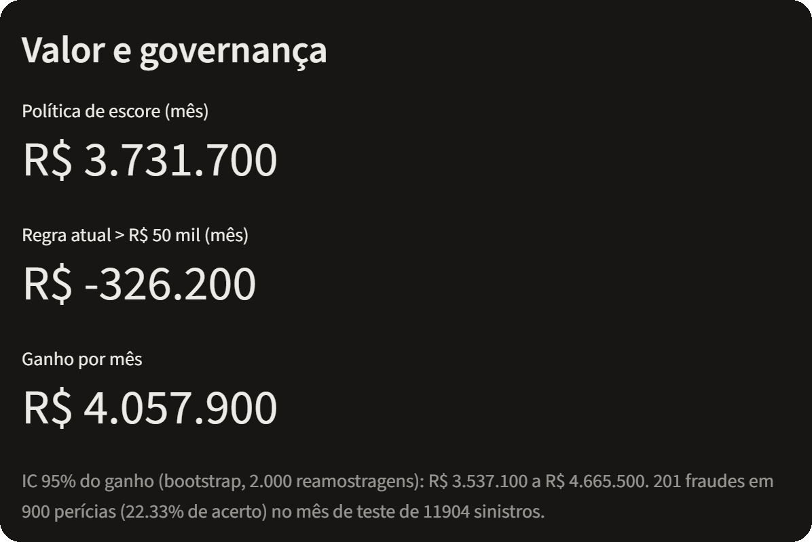

<h1 align="center">Priorização de Perícias em Sinistros de Automóvel</h1>

<p align="center">
  <strong>Quilha Seguros</strong><br>
  Política de triagem orientada por dados, com capacidade mensal limitada
</p>

<p align="center">
  <a href="https://www.python.org/"></a>
  <a href="https://streamlit.io/"></a>
  <a href="LICENSE"></a>
  <a href="https://github.com/flaviohenriquehb777/Auto-Insurance-Fraud/actions/workflows/ci.yml"></a>
</p>

<p align="center">
  <a href="https://quilha-triagem.streamlit.app/">
    
  </a>
</p>

<p align="center"><a href="https://quilha-triagem.streamlit.app/"><strong>▶ Abrir demonstração interativa</strong></a> — captura estática acima é da tela <em>Valor e governança</em>.</p>

> **Escopo:** projeto de estudo de caso, não é um sistema de decisão autônoma nem um serviço de produção. O modelo prioriza a fila; a decisão de periciar continua humana.

## Sumário

- [Visão geral do modelo](#visao-geral-do-modelo)
- [Objetivos da análise](#objetivos-da-analise)
- [Estrutura do modelo e do repositório](#estrutura-do-modelo-e-do-repositorio)
- [Base de dados](#base-de-dados)
- [Metodologia de análise: CRISP-DM](#metodologia-de-analise-crisp-dm)
- [Resultados-chave e apresentação](#resultados-chave-e-apresentacao)
- [Tecnologias utilizadas](#tecnologias-utilizadas)
- [Instalação e uso](#instalacao-e-uso)
- [Publicação no GitHub Pages](#publicacao-no-github-pages)
- [Licença](#licenca)
- [Contato](#contato)

## Visão geral do modelo

O projeto aborda a alocação de **900 perícias por mês** entre sinistros de automóvel. Em vez de
classificar casos por um limiar genérico, o Pipeline calcula um escore de priorização e organiza a
fila para que a equipe avalie primeiro os casos de maior prioridade estimada.

O artefato final é um Pipeline serializado (preparação, imputação e XGBoost), com **18 features**
conhecidas no momento da abertura do sinistro. Ele não declara que uma pessoa cometeu fraude: a
interface comunica prioridade operacional, apresenta sinais explicativos e mantém a decisão sob
responsabilidade do perito.

## Objetivos da análise

- Comparar uma política de escore com a regra atual baseada em valor reclamado acima de R$ 50 mil.
- Maximizar o resultado líquido dentro da capacidade fixa de perícia.
- Validar o modelo com separação temporal, usando sinistros futuros como holdout.
- Tornar explícitos os contratos de entrada, a explicabilidade e os gatilhos de monitoramento.
- Entregar uma interface que organiza a fila sem emitir veredito sobre o segurado.

## Estrutura do modelo e do repositório

O fluxo de pontuação é:

```text
Payload CSV → contrato de dados → preparo → imputação → XGBoost
            → ordenação por escore → corte proporcional em k → fila para revisão humana
```

| Caminho | Responsabilidade |
|---|---|
| `src/quilha/contrato.py` | Valida campos e recusa o lote inteiro quando há entrada inválida. |
| `src/quilha/preparacao.py` | Prepara as 18 features canônicas do Pipeline. |
| `src/quilha/pipeline.py` | Carrega e valida o artefato serializado. |
| `src/quilha/app.py` | Fila, análise individual, valor e governança no Streamlit. |
| `src/quilha/avaliacao.py` | Políticas, métricas econômicas, backtest e Quadro de Respostas. |
| `src/quilha/relatorio.py` | Gera o resumo executivo DOCX usando o CSV auditado como fonte única. |
| `notebooks/clean/06_consolidado.py` | Fonte Jupytext do notebook consolidado das Fases 1 a 6. |
| `tests/` | Testes de contrato, aplicação, avaliação e geração de relatório. |
| `docs/` | Pareceres, método, decisões e documentação das fases. |

## Base de dados

A base do estudo de caso contém **60.000 sinistros rotulados** e **17 colunas**, cobrindo o período
de abril a agosto de 2026. Há **1.480 casos rotulados como fraude (2,47%)**. O holdout temporal é
agosto de 2026, com 11.904 sinistros; abril a julho compõem o período de treino.

`valor_indenizado` (resultado posterior ao fechamento), identificadores e campos de data/hora
originais não entram como preditores. A decisão de implantação registrada em
[docs/06_implantacao.md](docs/06_implantacao.md) confirma que as features mantidas estão disponíveis
no momento da abertura.

O app aceita arquivos **CSV** de sinistros abertos e valida o esquema antes de pontuar. Use apenas
dados autorizados; não envie dados pessoais ou operacionais a uma demonstração pública.

## Metodologia de análise: CRISP-DM

| Fase | Trabalho realizado | Documentação |
|---|---|---|
| 1. Entendimento do negócio | Objetivo econômico, capacidade de 900 perícias e critérios de sucesso. | [Fase 1](docs/01_entendimento_negocio.md) |
| 2. Entendimento dos dados | Perfil da base, qualidade, alvo e sinais exploratórios. | [Fase 2](docs/02_entendimento_dados.md) |
| 3. Preparação dos dados | Contrato analítico, transformação e features sem vazamento. | [Fase 3](docs/03_preparacao_dados.md) |
| 4. Modelagem | Baselines, validação temporal, seleção e explicabilidade. | [Fase 4](docs/04_modelagem.md) |
| 5. Avaliação | Política econômica, robustez, incerteza e governança. | [Fase 5](docs/05_avaliacao.md) |
| 6. Implantação | Artefato, contrato de entrada, app, monitoramento e entregáveis. | [Fase 6](docs/06_implantacao.md) |

## Resultados-chave e apresentação

Os valores abaixo são resultados medidos no holdout de agosto de 2026, sob as premissas do estudo
de caso. Não são uma promessa de resultado futuro.

| Indicador | Resultado |
|---|---:|
| Referência simples (`DummyClassifier`, PR AUC) | 0,024929 |
| XGBoost, validação cruzada no treino (ROC AUC / PR AUC) | 0,940794 / 0,519659 |
| XGBoost, holdout temporal (ROC AUC / PR AUC) | 0,936597 / 0,538556 |
| Fraudes encontradas no corte auditado | 201 em 900 perícias (precisão de 22,33%) |
| Resultado líquido da política de escore | R$ 3.731.700,00 no mês de teste |
| Resultado líquido da regra atual, com 900 perícias | −R$ 326.200,00 no mês de teste |
| Ganho da política sobre a regra atual | R$ 4.057.900,00; IC 95% bootstrap: R$ 3.537.100,00 a R$ 4.665.500,00 |

O modelo foi selecionado por resultado líquido sob capacidade, não por acurácia. A conclusão depende
das premissas do case (inclusive que a perícia encontra uma fraude quando ela existe) e deve ser
reavaliada com dados operacionais antes de qualquer uso real. Consulte [Avaliação](docs/05_avaliacao.md)
e o [parecer da Fase 6](docs/06_implantacao.md) para método, ressalvas e decisões.

### Entregáveis reproduzíveis

- **Notebook consolidado:** a fonte versionada é `notebooks/clean/06_consolidado.py`; o `.ipynb`
  executado é gerado localmente pelo comando da seção [Instalação e uso](#instalacao-e-uso).
- **Resumo executivo:** gerado por `src/quilha/relatorio.py` a partir de
  `reports/tabelas/avaliacao_quadro_respostas.csv`.

Por configuração do repositório, `06_consolidado.ipynb` e `Relatorio_Quilha_Fraude.docx` são
artefatos locais ignorados pelo Git; eles não aparecem como arquivos baixáveis neste repositório.

## Tecnologias utilizadas

| Área | Ferramentas |
|---|---|
| Linguagem e ambiente | Python 3.12, `uv` |
| Dados e modelagem | pandas, NumPy, scikit-learn, XGBoost, LightGBM |
| Explicabilidade e interface | SHAP, Streamlit |
| Experimentação e análise | MLflow, Jupyter, Jupytext |
| Relatórios e qualidade | python-docx, pytest, Ruff, GitHub Actions |

## Instalação e uso

Pré-requisitos: **Python 3.12** e [`uv`](https://docs.astral.sh/uv/).

```powershell
git clone https://github.com/flaviohenriquehb777/Auto-Insurance-Fraud.git
Set-Location Auto-Insurance-Fraud
uv sync --all-groups
uv run streamlit run app.py
```

Sem upload de arquivo, o app abre com o lote de demonstração do mês de teste. Para usar outro lote,
envie um CSV com os campos aceitos pelo contrato; uma linha inválida faz o app recusar o lote
completo, em vez de produzir uma fila parcial.

Para reproduzir os dois entregáveis locais:

```powershell
# Notebook executado (a fonte Jupytext permanece versionada)
uv run jupytext --to notebook --execute notebooks/clean/06_consolidado.py -o 06_consolidado.ipynb

# Resumo executivo DOCX (o pacote do projeto está em src/)
$env:PYTHONPATH = "src"
uv run python -m quilha.relatorio
```

Para validar código e testes:

```powershell
uv run ruff check src tests
uv run pytest -q
```

## Publicação no GitHub Pages

**GitHub Pages hospeda conteúdo estático; não executa este app Python/Streamlit.** Se usado, Pages
pode publicar uma página de apresentação e documentação do projeto. A demonstração interativa deve
ser implantada separadamente, por exemplo no
[Streamlit Community Cloud](https://docs.streamlit.io/deploy/streamlit-community-cloud).

A demonstração interativa está publicada em:

> **[quilha-triagem.streamlit.app](https://quilha-triagem.streamlit.app/)**

A captura no topo deste README é clicável e leva direto ao app. O deploy é feito a partir da
branch `feature/fase-6-implantacao`, com Python 3.12 e dependências resolvidas pelo `uv.lock`.

## Licença

Este projeto está licenciado sob a [MIT License](LICENSE).

## Contato

| Canal | Link / contato |
|---|---|
| Nome | Flávio Henrique Barbosa |
| LinkedIn | [linkedin.com/in/flavio-henrique-barbosa-38465938](https://www.linkedin.com/in/flavio-henrique-barbosa-38465938) |
| E-mail | [flaviohenriquehb777@outlook.com](mailto:flaviohenriquehb777@outlook.com) |

<p align="center">
  <a href="https://www.linkedin.com/in/flavio-henrique-barbosa-38465938">
    
  </a>
</p>
