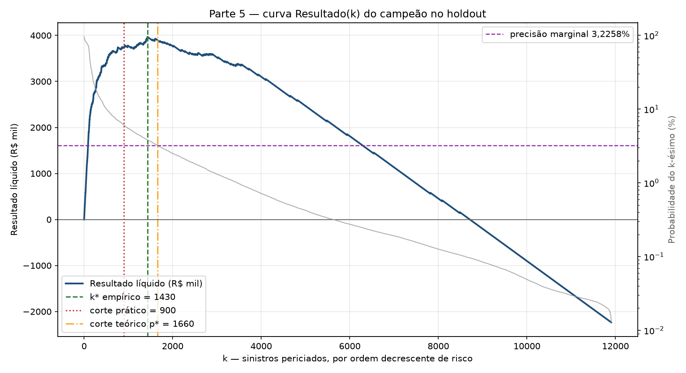
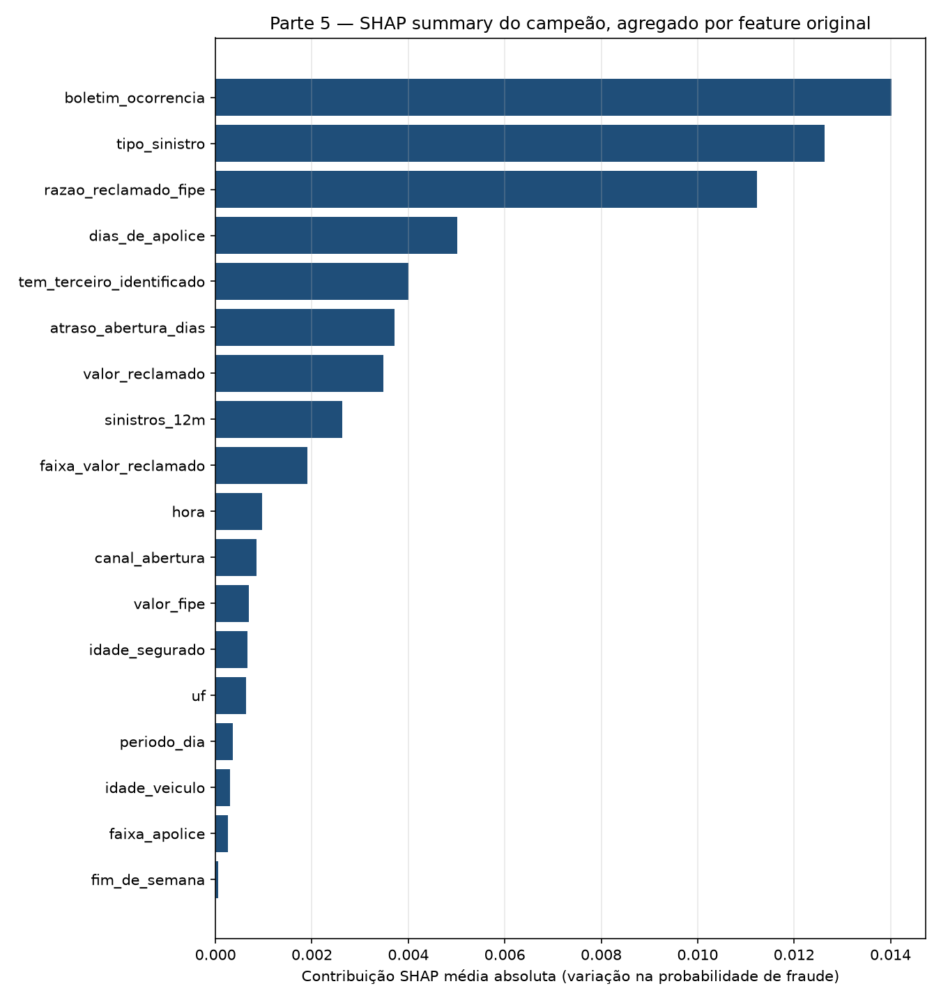

# Fase 4 — Modelagem

> **Projeto:** Detecção de fraude em sinistros de automóvel — Quilha Seguros
> **Fase CRISP-DM:** 4 de 6 — Modelagem
> **Execução:** 2026-11-07
> **Notebook executado:** [`notebooks/executed/04_modelagem.ipynb`](../notebooks/executed/04_modelagem.ipynb)
> **Fonte jupytext:** [`notebooks/clean/04_modelagem.py`](../notebooks/clean/04_modelagem.py)
> **Artefato do aplicativo:** [`models/pipeline_fraude.joblib`](../models/pipeline_fraude.joblib)

## 1. Decisão da fase

O campeão é o **XGBoost sem reamostragem**, com `scale_pos_weight=1`, escolhido pelo
maior Resultado Líquido@900 no holdout temporal de agosto. No corte operacional de
900 perícias, obteve Resultado Líquido de **R$ 3.731.700**, com 201 fraudes detectadas,
699 perícias em sinistros legítimos e 80 fraudes não detectadas.

O pipeline completo — preparo, imputação e classificador — foi reajustado nos
48.096 sinistros de abril a julho, salvo e recarregado. As probabilidades antes e
depois da serialização foram idênticas no holdout (`diferença máxima = 0`).

## 2. Protocolo e baselines

O holdout é cronológico: agosto/2026, 11.904 sinistros e 281 fraudes. O treino contém
48.096 sinistros e 1.199 fraudes. A validação cruzada usa cinco folds estratificados
somente no treino; em cada fold, o Pipeline inteiro é ajustado de novo. A capacidade
mensal de 900 é convertida em `k=720` para os folds de aproximadamente 9.619 linhas.

| Modelo base | PR AUC CV (média ± DP) | ROC AUC CV (média ± DP) | Precisão@720 (média ± DP) | Resultado@720 (média ± DP) |
|---|---:|---:|---:|---:|
| LightGBM | 0,4900 ± 0,0296 | 0,9327 ± 0,0078 | 0,2328 ± 0,0105 | R$ 3.132.920 ± 163.544 |
| Random Forest | 0,4884 ± 0,0281 | 0,9119 ± 0,0159 | 0,2228 ± 0,0154 | R$ 2.976.680 ± 240.958 |
| XGBoost | 0,4656 ± 0,0368 | 0,9234 ± 0,0105 | 0,2222 ± 0,0079 | R$ 2.968.000 ± 122.754 |
| Árvore de decisão | 0,1370 ± 0,0211 | 0,6732 ± 0,0171 | 0,1328 ± 0,0103 | R$ 1.570.520 ± 161.370 |
| Dummy prior | 0,0249 ± 0,0000 | 0,5000 ± 0,0000 | 0,0261 ± 0,0055 | −R$ 96.040 ± 85.982 |
| Regra Atual Quilha | 0,0245 ± 0,0002 | 0,4877 ± 0,0093 | 0,0172 ± 0,0057 | −R$ 234.920 ± 88.944 |

PR AUC tem como referência a prevalência da base (2,47%), não 0,5. A acurácia não é
usada para selecionar modelos. As métricas dos cinco primeiros baselines vêm de runs
anteriores; como a run histórica da Regra Atual não persistiu os scores CV, essa linha
foi recalculada com o mesmo `StratifiedKFold`, `SEED=42` e `k=720`, sem usar o holdout.
Tabela completa e IDs: [`parte2_cv_seis_modelos.csv`](../reports/tabelas/parte2_cv_seis_modelos.csv).

## 3. Busca e escolha do campeão

As quatro famílias ajustadas usaram o mesmo protocolo de CV. A seleção de cada família
considerou primeiro o Resultado Líquido@720 médio; o holdout foi usado depois para
medir as configurações finalistas.

| Família | PR AUC CV (média ± DP) | ROC AUC CV (média ± DP) | Resultado@720 CV (média ± DP) | PR AUC holdout | ROC AUC holdout | Resultado@900 |
|---|---:|---:|---:|---:|---:|---:|
| XGBoost | 0,5197 ± 0,0419 | 0,9408 ± 0,0067 | R$ 3.293.500 ± 125.598 | 0,5386 | 0,9366 | **R$ 3.731.700** |
| LightGBM | 0,5192 ± 0,0532 | 0,9403 ± 0,0078 | R$ 3.211.040 ± 145.082 | 0,5223 | 0,9321 | R$ 3.579.800 |
| Random Forest | 0,5065 ± 0,0273 | 0,9368 ± 0,0081 | R$ 3.176.320 ± 142.792 | 0,5079 | 0,9272 | R$ 3.536.400 |
| Árvore de decisão | 0,4528 ± 0,0308 | 0,9066 ± 0,0060 | R$ 2.963.660 ± 148.292 | 0,4742 | 0,8968 | R$ 3.297.700 |

### Parâmetros do XGBoost campeão

`max_depth=4`, `n_estimators=350`, `learning_rate=0,03`, `subsample=0,85`,
`colsample_bytree=0,7`, `gamma=3`, `min_child_weight=5`, `reg_lambda=1`,
`scale_pos_weight=1`.

- Profundidade 4 limita a complexidade das árvores e o risco de ajuste excessivo.
- 350 árvores com taxa de aprendizado 0,03 constroem o ranking em passos pequenos.
- `subsample=0,85` e `colsample_bytree=0,7` adicionam aleatoriedade controlada e
  reduzem dependência de linhas e atributos individuais.
- `gamma=3`, `min_child_weight=5` e `reg_lambda=1` exigem ganho e suporte para novos
  ramos e regularizam os pesos.
- `scale_pos_weight=1` evita inflar as probabilidades. Isso preserva a interpretação
  do corte teórico de 3,2258% e a probabilidade entregue ao analista.

As curvas de profundidade da árvore e da floresta estão em
[`04_01_decision_tree_profundidade.png`](../reports/figures/04_01_decision_tree_profundidade.png)
e [`04_02_random_forest_profundidade.png`](../reports/figures/04_02_random_forest_profundidade.png).
A busca completa, poda e vencedores estão em `reports/tabelas/parte3_*.csv`.

## 4. Under-sampling

As estratégias aleatórias 1:5 e 1:10 não superaram o controle de forma consistente.
NearMiss-1 descartou negativos informativos e degradou fortemente o ranking.

| Família / estratégia | PR AUC holdout | TP@900 | Resultado@900 |
|---|---:|---:|---:|
| XGBoost — controle | 0,5386 | 201 | **R$ 3.731.700** |
| XGBoost — aleatório 1:5 | 0,5294 | 199 | R$ 3.688.300 |
| XGBoost — aleatório 1:10 | 0,5328 | 196 | R$ 3.623.200 |
| LightGBM — aleatório 1:5 | 0,5195 | 195 | R$ 3.601.500 |
| Árvore — NearMiss 1:10 | 0,0599 | 45 | R$ 346.500 |

A tabela completa das 20 combinações está em
[`parte4_amostragem.csv`](../reports/tabelas/parte4_amostragem.csv), com o custo
informacional explícito nos números de holdout.

## 5. Custo 31:1 e decisão de negócio

Uma fraude paga que não é detectada custa **R$ 21.700**; cada perícia custa **R$ 700**.
Assim, `21.700 / 700 = 31`: uma perícia custa o mesmo que 1/31 de uma fraude paga.
O corte unitário de viabilidade é:

```text
p* = custo da perícia / custo de uma fraude paga
   = 700 / 21.700
   = 0,032258... = 3,2258%
```

A função de custo é `21.700 × FN + 700 × FP`. “Custo evitado” é `21.700 × TP`; o
Resultado Líquido subtrai o custo das perícias desse valor. Na prática, a capacidade
fixa de 900 prevalece sobre o corte probabilístico quando a fila tem mais de 900 casos.

| Família | Corte teórico: perícias | Custo total | Custo evitado | Resultado líquido | Corte prático: custo total | Custo evitado | Resultado líquido |
|---|---:|---:|---:|---:|---:|---:|---:|
| XGBoost | 1.660 | R$ 2.040.500 | R$ 5.056.100 | **R$ 3.894.100** | R$ 2.225.300 | R$ 4.361.700 | **R$ 3.731.700** |
| LightGBM | 6.720 | R$ 4.596.900 | R$ 6.010.900 | R$ 1.306.900 | R$ 2.382.100 | R$ 4.209.800 | R$ 3.579.800 |
| Random Forest | 8.193 | R$ 5.583.200 | R$ 6.054.300 | R$ 319.200 | R$ 2.426.900 | R$ 4.166.400 | R$ 3.536.400 |
| Árvore de decisão | 1.361 | R$ 2.548.000 | R$ 4.361.700 | R$ 3.409.000 | R$ 2.673.300 | R$ 3.927.700 | R$ 3.297.700 |

**Resposta medida:** sim. O XGBoost tem o maior Resultado Líquido nos cortes teórico
e prático e, no corte prático, o menor custo total entre as quatro famílias. No corte
teórico, o Random Forest evita nominalmente mais perdas (R$ 6.054.300), mas ordena
8.193 perícias e seu custo total reduz o resultado a R$ 319.200. Portanto, custo
evitado isolado não é o critério de decisão.

No corte prático do XGBoost: `TP=201`, `FP=699`, `FN=80`;
`21.700 × 80 + 700 × 699 = R$ 2.225.300`; perdas evitadas:
`21.700 × 201 = R$ 4.361.700`; saldo: **R$ 3.731.700**.

O corte teórico não deve ser aplicado diretamente às probabilidades do LightGBM com
`scale_pos_weight=39,11` nem do Random Forest com `class_weight="balanced"`: os pesos
alteram sua calibração. O ranking @900 continua sendo comparável.



Na curva do campeão, o ótimo empírico foi `k=1.430` (R$ 3.968.300), o corte teórico
incluiu 1.660 perícias (R$ 3.894.100) e a capacidade operacional ficou em 900
(R$ 3.731.700). Os valores não autorizam ultrapassar a capacidade mensal.

## 6. Robustez, calibração e ablação

Nas cinco sementes `(42, 7, 2026, 123, 99)`, o Resultado@900 médio foi
**R$ 3.731.700 ± R$ 15.344**. A amplitude observada foi R$ 3.710.000 a R$ 3.753.400.

| Calibração | Brier |
|---|---:|
| XGBoost sem calibração | **0,014702** |
| Isotonic | 0,014688 |
| Sigmoid | 0,015210 |

O modelo bruto foi mantido: isotonic melhora o Brier em aproximadamente 0,000014,
diferença marginal que não compensa a transformação adicional; sigmoid piora. A
ablação de `uf` e `idade_segurado` alterou ROC AUC em `+0,000569`, mas reduziu PR AUC
em `−0,004764`; as features foram mantidas.

## 7. SHAP

Importância média absoluta agregada por feature original, em 300 sinistros:

| Posição | Feature | Importância SHAP |
|---:|---|---:|
| 1 | `boletim_ocorrencia` | 0,014021 |
| 2 | `tipo_sinistro` | 0,012628 |
| 3 | `razao_reclamado_fipe` | 0,011226 |
| 4 | `dias_de_apolice` | 0,005010 |
| 5 | `tem_terceiro_identificado` | 0,004004 |
| 18 | `fim_de_semana` | 0,000058 |

`fim_de_semana` ficou por último, com importância cerca de 240 vezes menor que a
primeira feature; o resultado confirma baixo valor preditivo, mas não justifica
alterar o conjunto aprovado nesta fase.

| Caso de negócio | Índice no holdout | Probabilidade | Sinais SHAP locais principais |
|---|---:|---:|---|
| Fraude pega | 11.273 | 0,9561 | `razao_reclamado_fipe` +0,1689; `tipo_sinistro` +0,1651; `faixa_valor_reclamado` +0,1577 |
| Fraude perdida | 2.480 | 0,0606 | `dias_de_apolice` +0,0485; `boletim_ocorrencia` +0,0238; `razao_reclamado_fipe` +0,0140 |
| Legítimo no topo (falso positivo) | 8.809 | 0,8780 | `dias_de_apolice` +0,3159; `faixa_valor_reclamado` +0,1660; `tipo_sinistro` +0,1351 |



As três explicações locais estão em
[`parte5_shap_local_fraude_pega.png`](../reports/figures/parte5_shap_local_fraude_pega.png),
[`parte5_shap_local_fraude_perdida.png`](../reports/figures/parte5_shap_local_fraude_perdida.png)
e [`parte5_shap_local_legitimo_topo.png`](../reports/figures/parte5_shap_local_legitimo_topo.png).

## 8. Integração, MLOps e portabilidade

- `models/pipeline_fraude.joblib` contém `preparo → imputacao → XGBClassifier`; tamanho
  observado: **449.791 bytes**. `pipeline_fraude.versoes.json` é gerado ao lado e
  continua fora do Git, conforme a decisão de reprodutibilidade do projeto.
- A comparação de `predict_proba` antes e depois de `salvar_pipeline`/`carregar_pipeline`
  resultou em diferença máxima `0`.
- O notebook foi executado com `MLFLOW_TRACKING_URI`, `MLFLOW_TRACKING_USERNAME` e
  `MLFLOW_TRACKING_PASSWORD` ausentes. O tracking caiu para SQLite local e a execução
  terminou com sucesso; as rotinas também continuam aptas a usar DagsHub quando as
  três variáveis estão configuradas.
- O logger agora devolve `models:/<model_id>` no MLflow 3 quando a API cria um
  LoggedModel. Isso evita publicar uma URI `runs:/.../pipeline` que o DagsHub não
  consegue resolver.
- A execução local do notebook registrou o Pipeline completo. Run de integração:
  `e4237e7b4ce747679b76181c648b3e06`; URI retornada:
  `models:/m-1d80792f1207493eaa934077974c3cf6`.
- No DagsHub, as nove runs da Parte 5 foram espelhadas; o modelo
  `quilha-fraude-campeao` v1 aponta para o run `d8e2799899ac4fa2aa0320ee430a7700`
  com alias `champion` (confirmação registrada durante a execução da Parte 5).
- O notebook não contém caminhos absolutos e obtém a raiz subindo até `pyproject.toml`.
  As tabelas e figuras das buscas anteriores são lidas de caminhos relativos à raiz.

## 9. Runs de referência

| Experimento | Runs de referência |
|---|---|
| CV dos seis baselines | IDs em `parte2_cv_seis_modelos.csv`; revalidação da Regra Atual: `8ad86787c00840d68584d9a412d57e64` |
| Vencedores da Parte 3 | Árvore `e048f69c2e9e4757a6bf3c43d990d306`; LightGBM `c8f552b0098d4586b0085ef5a6715448`; RF `e7acb2dc9e194b15bd8d598cbb26e67d`; XGBoost `e328a1ee316d449d924bc7feee6817ef` |
| Custo 31:1, Parte 5 | Runs de família registrados em `parte5_custo31_familias.csv` |
| Robustez, Parte 5 | Cinco runs registrados em `parte5_sementes_campeao.csv`; a seed 42 local é `ee85557fcb394acab8f13aca63d50da2` |
| Registro DagsHub | Run `d8e2799899ac4fa2aa0320ee430a7700`; `quilha-fraude-campeao` v1, alias `champion` |
| Integração local, Parte 6 | Run `e4237e7b4ce747679b76181c648b3e06`; alias local atualizado para a versão 4 |

As tabelas das Partes 3 a 5 incluem as colunas `run_id` para auditoria individual.
As runs de tracking local vivem em `mlflow.db`, que não é versionado.

## 10. Critérios de aceite e limites

| Critério | Estado / evidência |
|---|---|
| Seis baselines na mesma CV, Pipeline dentro dos folds | Concluído; tabela com cinco folds e `k=720` |
| Acurácia fora dos critérios de decisão | Concluído; não usada |
| Sem ajuste no holdout durante CV e busca | Concluído; holdout foi avaliado depois da seleção, para medir as finalistas e o campeão |
| Profundidade, pesos 31 e 39,11 e subamostragem | Concluído; gráficos e tabelas em `reports/` |
| Campeão, custo 31:1 e SHAP | Concluído; tabelas, gráficos e cinco sementes |
| Pipeline completo no MLflow e alias `champion` | Concluído; DagsHub e execução local |
| Notebook sem credenciais, artefato do app, lint e testes | Concluído; notebook executado, `ruff` verde e 50 testes passando |

**Limite de validação:** agosto foi o holdout temporal disponível e também participou
da comparação final das estratégias para escolher o campeão. Por isso, o Resultado@900
é evidência de seleção do projeto, não uma estimativa externa completamente intocada.
Antes de produção, a Fase 5 deve reavaliar a política em novos sinistros futuros e
monitorar calibração e desempenho após implantação.

**Conclusão da Fase 4:** Partes 0 a 6 concluídas. A promoção do PR draft para pronto e
o merge na `main` são ações de GitHub separadas e ainda dependem da decisão do responsável.
