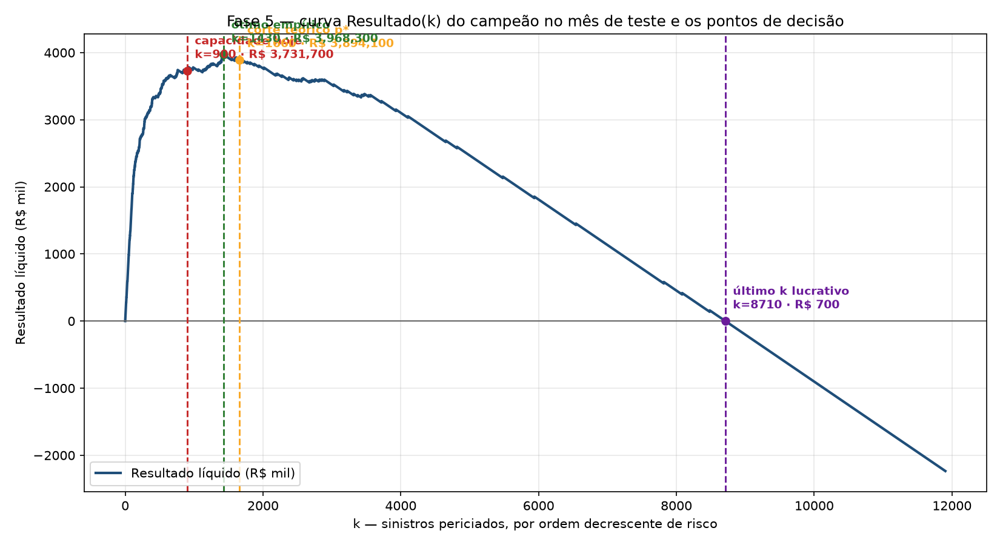
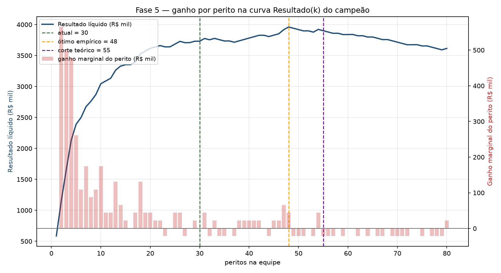
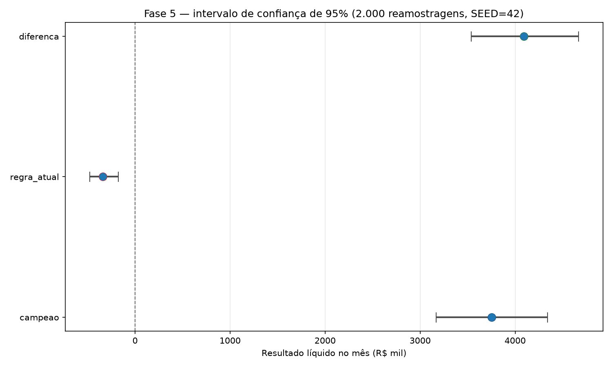

# Fase 5 — Avaliação

> **Projeto:** Detecção de fraude em sinistros de automóvel — Quilha Seguros
> **Fase CRISP-DM:** 5 de 6 — Avaliação (5.1 avaliar resultado · 5.2 revisar processo · 5.3 próximos passos)
> **Execução:** 2026-11-09
> **Notebook executado:** [`notebooks/executed/05_avaliacao.ipynb`](../notebooks/executed/05_avaliacao.ipynb)
> **Fonte jupytext:** [`notebooks/clean/05_avaliacao.py`](../notebooks/clean/05_avaliacao.py)
> **Artefato auditado:** [`models/pipeline_fraude.joblib`](../models/pipeline_fraude.joblib) — SHA-256 `65c7eb5e…bb10a3`
> **Módulo:** [`src/quilha/avaliacao.py`](../src/quilha/avaliacao.py) · **Testes:** [`tests/test_avaliacao.py`](../tests/test_avaliacao.py)

## 1. Decisão da fase

**Implantar** a política de **900 perícias/mês no escore do campeão** (XGBoost aprovado na Fase 4)
e **extinguir o critério de R$ 50 mil** como regra de triagem, **mantendo os 30 peritos**.

Fora da amostra (4 janelas walk-forward, mai–ago/2026), a política rende
**R$ 4,33 milhões/mês** a mais que a regra atual; no bootstrap pareado do mês de teste a diferença
é **R$ 4,09 milhões**, com IC 95% **[R$ 3,54M; R$ 4,67M]** que **exclui o zero**; e na grade de
sensibilidade o campeão vence a regra em **100 de 100** cenários econômicos.

A decisão só é invalidada se a **Precisão@900 ficar abaixo de 3,2258% por dois meses seguidos** ou
o **Resultado@900 realizado ficar negativo** — quando a fila volta automaticamente à regra anterior
(circuit breaker, §9).

Em uma frase: **a política só é pior que a regra atual se o topo da fila deixar de concentrar
fraude acima do piso de 3,2258%; nada no que foi medido indica isso.**

## 2. Reconciliação com o case e o critério da decisão (Parte 0)

Os parâmetros econômicos do Anexo 1 são **importados** de `quilha.modelagem` (fonte única, para a
Fase 5 não divergir da Fase 4) e o piso é **derivado na célula**, não copiado:

```text
custo da perícia        = R$ 700,00
custo da fraude paga    = R$ 21.700,00
p* = 700 / 21.700       = 0,032258  (3,2258%)       razão de custo = 31 : 1
Resultado(k) = 21.700 × TP(k) − 700 × k,   sujeito a k ≤ 900/mês
```

O piso (3,2258%) está **acima** da taxa de fraude da base (2,47%): periciar ao acaso dá prejuízo.
A política só cria valor por **concentração** — precisa empurrar fraudes para o topo da fila com
precisão acima do piso. A conferência `resultado_liquido(tp=1, k=31) = R$ 0,00` fecha a conta:
31 perícias custam exatamente uma fraude paga. Como referência de "não periciar ninguém":
`21.700 × 281 fraudes de agosto = R$ 6.097.700`.

## 3. Auditoria do que está sendo avaliado (Parte 1)

Antes de qualquer número de negócio, provou-se que a política avaliada é **exatamente** o artefato
aprovado na Fase 4:

- Pipeline `['preparo', 'imputacao', 'modelo']`, estimador final `XGBClassifier`.
- Os 9 hiperparâmetros do artefato conferem com o documento da Fase 4 (todos `OK`).
- As **18 features** conferem com a ordem canônica de `preparacao.FEATURES`.
- **Teste de fumaça:** o artefato reproduz `Resultado@900 = R$ 3.731.700` com `TP=201`, `FP=699`,
  `FN=80` — idêntico à Fase 4.

| Item | Valor |
|---|---|
| SHA-256 do artefato | `65c7eb5ea1325f4911f9223fa3bf1d2f7aec909e77a30865a47f25a837bb10a3` |
| Resultado@900 reproduzido | R$ 3.731.700 (`TP=201` · `FP=699` · `FN=80`) |

Não reproduzir invalidaria tudo o que vem depois; reproduziu, e o hash amarra esta fase a esse
arquivo exato.

## 4. Estimativa honesta fora da amostra — backtest walk-forward (Parte 2)

O limite herdado da Fase 4 era: agosto foi o **único** holdout **e** participou da escolha do
campeão. Por isso a estimativa que carrega a decisão **não** pode ser o R$ 3.731.700 de agosto.

O backtest usa **origem móvel**: em cada janela o Pipeline inteiro é **re-ajustado com `clone`**
sobre o treino expansivo e avaliado no mês seguinte (sem vazamento). O `k` de cada janela é
proporcional à capacidade (`round(900 × n / 12.024)`), porque os meses variam de tamanho.

| Janela | Treino | `k` | Campeão | Regra atual | Aleatória | Campeão − regra |
|---|---|---:|---:|---:|---:|---:|
| 2026-05 | 2026-04 | 909 | R$ 3.964.100 | −R$ 310.800 | −R$ 72.100 | R$ 4.274.900 |
| 2026-06 | abr–mai | 894 | R$ 4.169.900 | −R$ 408.800 | −R$ 83.300 | R$ 4.578.700 |
| 2026-07 | abr–jun | 921 | R$ 4.042.500 | −R$ 319.200 | −R$ 167.300 | R$ 4.361.700 |
| 2026-08 | abr–jul | 891 | R$ 3.738.000 | −R$ 363.300 | −R$ 211.400 | R$ 4.101.300 |
| **média ± DP** | | | **R$ 3.978.625 ± 181.455** | **−R$ 350.525 ± 45.161** | −R$ 133.525 ± 67.084 | **R$ 4.329.150 ± 198.489** |

O reajuste da última janela reproduz o artefato auditado com **diferença máxima de probabilidade
`0`** (`R$ 3.731.700`, `TP=201`): o backtest mede o mesmo modelo da prateleira. A degradação
temporal é suave (primeira janela R$ 3.964.100 → última R$ 3.738.000, variação −R$ 226.100) e a
diferença pareada é **muito acima do ruído** (média ≫ desvio). Tabela completa:
[`avaliacao_backtest.csv`](../reports/tabelas/avaliacao_backtest.csv).

## 5. Política e economia — Pergunta 4 (Parte 3)

No mês de teste (agosto/2026), mesma capacidade e mesmo critério para as quatro políticas:

| Política | Periciados | TP | FP | FN | Precisão | Cobertura | Economia/mês | Custo total |
|---|---:|---:|---:|---:|---:|---:|---:|---:|
| **Campeão (escore XGBoost)** | 900 | 201 | 699 | 80 | 22,33% | 71,53% | **R$ 3.731.700** | R$ 2.225.300 |
| Não periciar ninguém | 0 | 0 | 0 | 281 | 0,00% | 0,00% | R$ 0 | R$ 6.097.700 |
| Regra atual (> R$ 50 mil) | 900 | 14 | 886 | 267 | 1,56% | 4,98% | **−R$ 326.200** | R$ 6.414.100 |
| Referência simples (prior) | 900 | 19 | 881 | 262 | 2,11% | 6,76% | −R$ 217.700 | R$ 6.302.100 |

A regra atual, medida **exatamente como o case a descreve** (`valor_reclamado > R$ 50 mil`, ordenado
por valor, corte em 900): 927 pedidos acima do limiar (o case fala em ~950), 14 fraudes encontradas.
Ou seja, a regra de R$ 50 mil **perde dinheiro** — é pior até que periciar ao acaso (prior).

**Ganho da política sobre a regra atual:** R$ 4.057.900/mês no mês de teste
(`21.700 × (201 − 14)` = R$ 4.057.900, com o **mesmo** número de perícias — a vantagem não vem de
periciar mais, vem de periciar melhor).

**Ação sobre a regra atual (decisão, não comentário):** *extinguir* o critério de R$ 50 mil como
regra de triagem e substituí-lo pela política de escore do campeão, mantidas as 900 perícias/mês.



Pontos de decisão sobre a curva `Resultado(k)`:

| Ponto | `k` | Resultado |
|---|---:|---:|
| Capacidade hoje | 900 | R$ 3.731.700 |
| Corte teórico (`precisão = piso`) | 1.660 | R$ 3.894.100 |
| Ótimo empírico | 1.430 | R$ 3.968.300 |
| Último `k` ainda lucrativo | 8.710 | R$ 700 |

## 6. Dimensionamento e valor marginal — Pergunta 5 (Parte 4)

**Acerto mínimo de uma perícia (a mais) para se pagar:** `700 / 21.700 = 3,2258%` — o mesmo piso da
Fase 1, agora visto do lado de quem decide contratar.

`Resultado(k)` sobe de R$ 3.731.700 (k=900) até R$ 3.968.300 no ótimo empírico (**k=1.430,
~48 peritos**) e desaparece em k=8.710. Contraprova por vizinhança: a última perícia que se paga é
`k=1.660` e a primeira que não se paga é `k=1.661` — confere. O ganho de ir das 900 ao ótimo é
**R$ 236.600/mês**.

| Peritos | `k` | Resultado | Ganho marginal do último perito |
|---:|---:|---:|---:|
| 30 (atual) | 900 | R$ 3.731.700 | R$ 700 |
| 48 (ótimo empírico) | 1.440 | R$ 3.961.300 | R$ 44.100 |
| 55 (corte teórico) | 1.650 | R$ 3.901.100 | −R$ 21.000 |

**Contraprova da tese do Otávio ("o dobro de peritos pega o dobro de fraude").** Com 1.800 perícias
o `TP` vai de 201 para **235** — múltiplo real **1,17×**, não 2× (a promessa exigiria 402). O topo
da fila concentra as fraudes mais óbvias, então a precisão marginal decresce.



**Ação sobre a equipe:** **manter os 30 peritos** (900 perícias/mês). O ganho de ir ao ótimo é
pequeno e o ótimo é *in-sample*, dentro da faixa de variação das janelas do backtest. Só ampliar se
a Precisão@900 seguir acima de 3,2258% **com folga**.

## 7. Sensibilidade, break-even e incerteza (Parte 5)

### 7.1 Incerteza — bootstrap pareado (2.000 reamostragens, SEED=42)

| Métrica | Média | DP | IC 95% |
|---|---:|---:|---:|
| Campeão | R$ 3.752.749 | R$ 291.151 | [R$ 3.167.500; R$ 4.339.300] |
| Regra atual | −R$ 337.365 | R$ 83.032 | [−R$ 478.642; −R$ 174.300] |
| **Diferença (campeão − regra)** | **R$ 4.090.114** | R$ 290.296 | **[R$ 3.537.100; R$ 4.665.500]** |

**Veredito:** o IC 95% da diferença **exclui o zero** — o ganho é distinguível do ruído. A tabela é
[`avaliacao_bootstrap.csv`](../reports/tabelas/avaliacao_bootstrap.csv).



### 7.2 Grade de sensibilidade econômica (100 células)

Custo da fraude ∈ {R$ 10k, 15k, 21,7k, 30k, 40k} × custo da perícia ∈ {R$ 500, 700, 1.000, 1.500}
× capacidade ∈ {600, 900, 1.200, 1.800, 2.400}. O campeão vence a regra em **0 de 100** cenários
perdedores — ganho de **R$ 1,81M a R$ 7,96M**. Um fator por vez (valores de referência fixos):

| Custo da fraude (perícia R$ 700, cap. 900) | Resultado campeão | Ganho s/ regra |
|---:|---:|---:|
| R$ 10.000 | R$ 1.380.000 | R$ 1.870.000 |
| R$ 15.000 | R$ 2.385.000 | R$ 2.805.000 |
| **R$ 21.700** | **R$ 3.731.700** | **R$ 4.057.900** |
| R$ 30.000 | R$ 5.400.000 | R$ 5.610.000 |
| R$ 40.000 | R$ 7.410.000 | R$ 7.480.000 |

| Custo da perícia (fraude R$ 21.700, cap. 900) | Resultado campeão |
|---:|---:|
| R$ 500 | R$ 3.911.700 |
| **R$ 700** | **R$ 3.731.700** |
| R$ 1.000 | R$ 3.461.700 |
| R$ 1.500 | R$ 3.011.700 |

| Capacidade (fraude R$ 21.700, perícia R$ 700) | `k` | TP campeão | Resultado campeão |
|---:|---:|---:|---:|
| 600 | 600 | 186 | R$ 3.616.200 |
| **900** | **900** | **201** | **R$ 3.731.700** |
| 1.200 | 1.200 | 213 | R$ 3.782.100 |
| 1.800 | 1.800 | 235 | R$ 3.839.500 |
| 2.400 | 2.400 | 244 | R$ 3.614.800 |

Tabela completa: [`avaliacao_sensibilidade.csv`](../reports/tabelas/avaliacao_sensibilidade.csv).
Figura: [`05_02_sensibilidade.png`](../reports/figures/05_02_sensibilidade.png).

### 7.3 Break-even e sensibilidade à prevalência

- **A própria política** deixa de se pagar se a fraude média custar menos de **R$ 3.134,33**
  (razão crítica **4,478 : 1**) — muito abaixo dos R$ 21.700 do case.
- A **regra atual**, com a mesma conta, exigiria fraude de **R$ 45.000** (razão 64,286 : 1) para
  zerar — ela só seria viável a um custo de fraude quase o dobro do case.
- **A vantagem sobre a regra não tem break-even em custo de fraude:** com o **mesmo `k`**, o ganho
  vale `custo_fraude × (TP_campeão − TP_regra)`, sempre positivo porque o campeão acha mais fraudes
  com o mesmo número de perícias. O break-even do projeto é, portanto, contra **não periciar**.
- **Drift de prevalência:** a política zera só se a taxa de fraude do fluxo cair para **0,3480%** —
  cerca de **9,3× abaixo** do piso absoluto (3,2258%), graças ao *lift* do topo da fila, e ~7×
  abaixo do colchão atual (2,36%). Sensibilidade à taxa: [`avaliacao_taxa_fraude.csv`](../reports/tabelas/avaliacao_taxa_fraude.csv).

## 8. Aceitabilidade, risco e explicabilidade (Parte 6)

### 8.1 O preço em reais de não usar `uf` e `idade_segurado`

| Cenário | Features | ROC AUC | PR AUC | `TP@900` | Resultado@900 |
|---|---:|---:|---:|---:|---:|
| Com idade e UF (campeão) | 18 | 0,936597 | **0,538556** | 201 | R$ 3.731.700 |
| Sem idade e UF (ablação) | 16 | 0,937166 | 0,533792 | 203 | R$ 3.775.100 |

**Posição:** *manter*. Remover as duas colunas **ganha** R$ 43.400/mês — um empate técnico
(~0,9% do desvio do bootstrap) — mas o **PR AUC cai** (0,5386 → 0,5338), e é o PR AUC que governa a
ordenação da fila. Como os dois efeitos são indistinguíveis de zero e a Fase 4 já aprovou o conjunto,
remover seria re-treino sem ganho demonstrado. *Contraponto honesto:* se a prioridade for governança
(idade e UF são proxies de características pessoais), a remoção é defensável — **custa
estatisticamente nada** neste holdout. A escolha é de negócio, e o número está na mesa.

### 8.2 Triagem de disparidade da fila periciada

Por **faixa de idade**, a fila é **plana**: a razão de seleção vai de **0,92×** (60 ou mais) a
**1,18×** (18 a 29) a média — longe de um limiar de alarme. A precisão, porém, sobe com a idade
(19,7% nos 18–29 contra 30,2% nos 60+), o que é desempenho, não viés de seleção segunda o volume.
As UFs com taxa extrema têm volume pequeno (SE `n=59`, AP/RR `n≤24`): triagem com `n` baixo é ruído,
e por isso a rotina trimestral usa um piso de amostra. Tabela: [`avaliacao_disparidade.csv`](../reports/tabelas/avaliacao_disparidade.csv).

### 8.3 Contingência do `boletim_ocorrencia` e o atributo morto

`boletim_ocorrencia` é a feature SHAP nº 1 e a única coluna com branco (4,83% da base, taxa de
fraude 3,24% — acima da média, então **nunca imputar**). Auditoria de perda do campo:

| Cenário | `TP@900` | Precisão@900 | Resultado@900 |
|---|---:|---:|---:|
| Com boletim | 201 | 22,33% | R$ 3.731.700 |
| Sem boletim | 186 | 20,67% | R$ 3.406.200 |

Perda se o campo sumir: **R$ 325.500/mês (8,72%)** — o modelo piora, mas **segue muito acima da
regra atual**. Regra de contingência: (1) a fila continua no escore, com reavaliação se a
Precisão@900 cair abaixo do piso por dois meses; (2) o branco vira categoria `'Não informado'`, nunca
imputação; (3) o indicador de branco entra no monitoramento.

`fim_de_semana` é confirmado **atributo morto**: 18º de 18 em importância SHAP (5,08e-05), cerca de
250× menor que a primeira feature. As três explicações locais do topo da fila (fundo congelado)
estão em [`avaliacao_shap_local.csv`](../reports/tabelas/avaliacao_shap_local.csv) — o caso nº 1
(índice 11.273, escore 0,9561, fraude) é explicado por `razao_reclamado_fipe` (+0,1752),
`tipo_sinistro` (+0,1691) e `faixa_valor_reclamado` (+0,1648). Importância global:
[`avaliacao_shap_importancia.csv`](../reports/tabelas/avaliacao_shap_importancia.csv).

## 9. Revisão do processo e próximos passos (Partes 7 — CRISP-DM 5.2 e 5.3)

### 9.1 O que funcionou (com evidência)

1. **Pipeline dentro do fold, sem vazamento** — o reajuste com `clone` por janela permitiu estimar
   fora da amostra.
2. **`scale_pos_weight=1` preservou a calibração** — o piso 3,2258% reapareceu intacto na Parte 4/5;
   o escore continua sendo probabilidade, não só ranking.
3. **A decisão não depende do mês nem dos parâmetros** — ganho positivo em 4 janelas **e** IC 95%
   que exclui o zero **e** 0/100 cenários econômicos negativos: três provas independentes.

### 9.2 O que custou caro (com evidência)

1. **Espelhar run a run no DagsHub** degradou de ~21s para ~206s por configuração na busca da Fase 4
   — a plataforma fica para o fim, não no laço de busca.
2. **A run histórica da Regra Atual não persistiu os escores** — a referência teve de ser revalidada
   na Fase 4, com o mesmo `StratifiedKFold` e `SEED=42`.
3. **O bootstrap re-executa a política 2.000 vezes** — pesado, porém foi o que provou que o ganho
   não é ruído.

### 9.3 O que agosto ensinou (método)

Não se usa a **única** janela disponível tanto para escolher quanto para reportar. Por isso a
estimativa que carrega a decisão é o **backtest walk-forward**; o holdout de agosto é **descritivo**.

### 9.4 Próximos passos — implantar, com condições

1. **Manter 30 peritos** (900 perícias/mês); ampliar só com folga de precisão confirmada.
2. **Fila de 900 no escore do campeão**, com revisão humana no topo de maior valor (escore, posição,
   3 sinais SHAP e texto curto).
3. **Gatilhos e circuit breaker ativos desde o dia 1** (quadro abaixo).
4. **Reavaliação trimestral.**

### 9.5 Plano de monitoramento (especificação para a Fase 6 — não implementação)

| Métrica mensal | Gatilho de alerta | Ação |
|---|---|---|
| Precisão@900 | < **3,2258%** por 2 meses seguidos | Recalibrar; se persistir, re-treinar |
| Resultado@900 realizado | < **R$ 0** | **Circuit breaker:** fila volta à regra anterior |
| Taxa de fraude do fluxo | < **0,35%** (equilíbrio 0,3480%) | Revisar a política com o comitê |
| % de `boletim_ocorrencia` em branco | > **10%** (baseline 4,83%) | Alerta; > **20%** aciona a contingência |
| PSI das features principais | > **0,25** | Re-treinar (deriva de população) |
| Distribuição do escore | share no top-900 desviando > 20% | Investigar deriva antes de periciar |

- **Circuit breaker:** se `Resultado@900` realizado ficar negativo ou a Precisão@900 cair abaixo do
  piso por dois meses consecutivos, a fila **volta automaticamente** à regra de R$ 50 mil; religar
  exige parecer do comitê.
- **Cadência:** recalibração trimestral; re-treino semestral (ou por gatilho).
- **Quem aprova:** comitê de risco e liderança de sinistros; o analista-chefe valida a legibilidade
  das explicações antes de cada liberação.

### 9.6 Frase de decisão da Fase 5

**Implantar** a política de 900 perícias/mês no escore do campeão: fora da amostra ela rende
**R$ 4,33 milhões/mês** sobre a regra de R$ 50 mil (bootstrap: **R$ 4,09M**, IC95%
**[R$ 3,54M; R$ 4,67M]**, exclui o zero; **0 de 100** cenários perdem), e a decisão só é invalidada
se a **Precisão@900 ficar abaixo de 3,2258% por dois meses seguidos** — quando a fila volta à regra
anterior automaticamente.

## 10. Quadro de Respostas (consolidado — Perguntas 1 a 5)

Fonte: [`avaliacao_quadro_respostas.csv`](../reports/tabelas/avaliacao_quadro_respostas.csv)
(24 de 24 campos preenchidos; **conferido contra as saídas do notebook**). Campos das Perguntas 1 a 3
vêm das Fases 2 a 4; das Perguntas 4 e 5, desta fase.

| Pergunta | Campo | Resposta |
|---|---|---|
| 1 | Colunas usadas no modelo final | 18 features: idade_segurado, dias_de_apolice, sinistros_12m, idade_veiculo, valor_fipe, valor_reclamado, hora, atraso_abertura_dias, razao_reclamado_fipe, tem_terceiro_identificado, canal_abertura, tipo_sinistro, uf, boletim_ocorrencia, periodo_dia, fim_de_semana, faixa_apolice, faixa_valor_reclamado |
| 1 | Colunas deixadas de fora | data_abertura, data_ocorrencia, hora_ocorrencia, id_sinistro, terceiro_identificado, valor_indenizado (chaves de controle, vazamento e a original redundante `terceiro_identificado`) |
| 1 | Idade do segurado e UF: usar ou não usar | Manter: remover `uf` + `idade_segurado` vale R$ 43.400,00/mês A FAVOR da remoção (empate técnico, 0,9% do desvio do bootstrap) e o PR AUC cai sem elas. |
| 1 | ROC AUC · PR AUC no teste: com idade e UF · sem idade e UF | Com idade e UF — ROC 0,936597 · PR 0,538556; sem as duas — ROC 0,937166 · PR 0,533792. |
| 2 | Taxa de fraude da base | 2,47% — 1.480 fraudes em 60.000 sinistros. |
| 2 | Taxa e nº por tipo: Colisão · Vidros · Roubo/Furto · Terceiros · Alagamento · Incêndio | Colisão: 31.443 sinistros (4,10% de fraude) · Vidros: 11.970 (0,01%) · Roubo/Furto: 5.908 (0,49%) · Terceiros: 5.842 (0,63%) · Alagamento: 3.002 (3,13%) · Incêndio: 1.835 (1,69%) |
| 2 | Taxa e nº por canal: App · Corretor · Central 0800 | App: 26.759 sinistros (2,19%) · Corretor: 20.899 (1,56%) · Central 0800: 12.342 (4,60%) |
| 2 | Taxa e nº por boletim: Sim · Não · em branco | Sim: 29.131 sinistros (1,17%) · Não: 27.970 (3,73%) · Não informado: 2.899 (3,24%) |
| 2 | Tratamento dado ao boletim em branco no modelo | Categoria própria 'Não informado' — 2.899 sinistros (4,83% da base), taxa 3,24%: acima da média, então NUNCA imputar (nem pela moda). |
| 2 | Taxa e nº por tempo de apólice: até 30 · 31 a 90 · 91 a 180 · 181 a 365 · +365 | até 30: 1.181 (13,46%) · 31 a 90: 2.319 (10,56%) · 91 a 180: 3.450 (8,96%) · 181 a 365: 8.119 (1,96%) · +365: 44.931 (1,35%) |
| 2 | Taxa e nº por valor reclamado: até 10 · 10–20 · 20–30 · 30–40 · 40–50 · 50–60 · +60 mil | até 10 mil: 38.954 (1,10%) · 10 a 20: 8.674 (2,78%) · 20 a 30: 3.354 (3,16%) · 30 a 40: 2.035 (2,95%) · 40 a 50: 2.231 (25,15%) · 50 a 60: 1.177 (3,48%) · +60: 3.575 (1,17%) |
| 3 | Modelos comparados · modelo recomendado | 6 modelos (Dummy prior · Regra atual Quilha · Árvore de decisão · Random Forest · XGBoost · LightGBM) — recomendado: XGBoost. |
| 3 | Período do treino · período do teste · nº de sinistros no teste | Treino 01/04/2026 a 31/07/2026 (48.096 sinistros, 2,49% de fraude) · teste 08/2026 (11.904 sinistros, 2,36%). |
| 3 | ROC AUC · PR AUC da referência simples no teste | ROC AUC 0,500000 · PR AUC 0,024929 (DummyClassifier prior). |
| 3 | ROC AUC · PR AUC no treino · no teste (modelo recomendado) | Treino — ROC 0,940794 · PR 0,519659; teste — ROC 0,936597 · PR 0,538556. |
| 4 | Política recomendada · perícias por mês | Escore do campeão, corte em top-900 (900 perícias/mês). |
| 4 | Fraudes encontradas · economia no mês: política recomendada | 201 fraudes · economia de R$ 3.731.700,00/mês (precisão 22,33%). |
| 4 | Fraudes encontradas · economia no mês: regra atual com 900 perícias | 14 fraudes · economia de −R$ 326.200,00/mês (perde até para periciar ao acaso). |
| 4 | Ganho da política sobre a regra atual, por mês | R$ 4.057.900,00/mês no mês de teste. |
| 4 | Ação sobre a regra atual | Extinguir o critério de R$ 50 mil como regra de triagem; substituí-lo pela política de escore do campeão, mantidas as 900 perícias/mês. |
| 5 | Acerto mínimo para uma perícia se pagar | 3,23% (700 / 21.700 = 1/31). |
| 5 | Perícias por mês de menor custo · ganho mensal além das 900 | k=1.430 (~48 peritos, R$ 3.968.300,00); ganho além das 900 = R$ 236.600,00/mês. |
| 5 | Fraudes encontradas com 1.800 perícias por mês | 235 fraudes com 1.800 perícias (múltiplo real 1,17× sobre as 201 das 900; a promessa de 2× exigiria 402). |
| 5 | Ação sobre a equipe | Manter os 30 peritos (900 perícias/mês); só ampliar se a Precisão@900 seguir acima de 3,23% com folga. |

## 11. Resposta à pergunta obrigatória da Fase 5

> *A política baseada no escore do campeão supera a regra atual de R$ 50 mil com as mesmas 900
> perícias — e esse ganho sobrevive (a) ao IC 95% da diferença e (b) à variação dos parâmetros
> econômicos do Anexo 1?*

**Sim.**

- **(a) Lado a lado (mês de teste, agosto/2026).** Campeão **201 fraudes**, economia
  **R$ 3.731.700/mês**; regra de R$ 50 mil **14 fraudes**, economia **−R$ 326.200/mês**;
  **diferença: R$ 4.057.900/mês**.
- **(b) IC 95% da diferença** (bootstrap pareado, 2.000 reamostragens, SEED=42): **R$ 4.090.114**,
  IC95% **[R$ 3.537.100; R$ 4.665.500]** — **exclui o zero**.
- **(c) Robustez econômica.** Na grade combinada (100 células), o campeão vence em **100 de 100**
  (ganho R$ 1,81M a R$ 7,96M). O break-even **contra a regra não existe** (mesmo `k`); contra
  **não periciar**, a política zera só se a taxa de fraude cair para **0,3480%**. O backtest
  walk-forward (4 janelas) confirma fora da amostra: média **+R$ 4.329.150/mês**, pior janela
  **+R$ 4.101.300**.
- **(d) Conclusão: implantar, com gatilhos.** Implantar a política, **manter 30 peritos** e
  **extinguir o critério de R$ 50 mil**. A fase só é invalidada se a **Precisão@900 ficar abaixo de
  3,2258% por dois meses seguidos** ou o **Resultado@900 realizado ficar negativo** — quando a fila
  volta automaticamente à regra anterior.

## 12. Entregáveis, MLOps e critérios de aceite

### 12.1 Entregáveis e artefatos

| Entregável | Onde | Estado |
|---|---|---|
| Módulo de decisão | [`src/quilha/avaliacao.py`](../src/quilha/avaliacao.py) | Pronto |
| Testes | [`tests/test_avaliacao.py`](../tests/test_avaliacao.py) | **7/7 passando** |
| Notebook limpo + executado | [`notebooks/clean/05_avaliacao.py`](../notebooks/clean/05_avaliacao.py) · [`notebooks/executed/05_avaliacao.ipynb`](../notebooks/executed/05_avaliacao.ipynb) | Pronto (executado) |
| Tabelas | `reports/tabelas/avaliacao_*.csv` (9 arquivos) | Pronto |
| Figuras | `reports/figures/05_*.png` (4 figuras) | Pronto |
| Quadro de Respostas | [`avaliacao_quadro_respostas.csv`](../reports/tabelas/avaliacao_quadro_respostas.csv) + §10 | Pronto |
| Runs MLflow (backtest · sensibilidade) | DagsHub, com `hash_artefato` nas tags | Pronto |

### 12.2 MLOps

- Runs registradas na Fase 5, no experimento do projeto: **backtest walk-forward**
  (`f55ba9322ebe42d0a94158f522fe18a8`) e **sensibilidade econômica**
  (`b89c2e62977549169a0eb256e27cc696`), ambas com o hash do artefato auditado
  (`hash_artefato=65c7eb5ea1325f49…`) nas tags, amarrando a fase ao `.joblib` exato.
- O notebook degrada para **SQLite local** (`mlflow.db`) sem credenciais, sem quebrar; com credenciais,
  sobe para o **DagsHub**.

### 12.3 Critérios de aceite (estado real)

| # | Critério | Estado / evidência |
|---|---|---|
| 1 | Parâmetros do Anexo 1 e piso de 3,2258% derivados em célula | Concluído — bloco impresso na Parte 0 |
| 2 | Artefato auditado por hash e **reproduz** R$ 3.731.700 no corte de 900 | Concluído — SHA-256 `65c7eb5e…`, `TP=201`, `FP=699`, `FN=80` |
| 3 | Backtest com ≥3 janelas, média ± desvio e diferença pareada | Concluído — 4 janelas; diferença R$ 4.329.150 ± 198.489 |
| 4 | P4 completa (perícias, fraudes, economia vs. não periciar, regra com 900, ganho e ação) | Concluído — tabela + ação de extinguir o critério de R$ 50 mil |
| 5 | P5 completa (acerto mínimo, `k` ótimo, ganho além das 900, 1.800 perícias e ação) | Concluído — `k=1.430`, +R$ 236.600/mês, 235 fraudes; manter 30 peritos |
| 6 | IC 95% por bootstrap do `Resultado@900` e da diferença | Concluído — diferença R$ 4.090.114 [R$ 3.537.100; R$ 4.665.500] |
| 7 | Grade de sensibilidade (custo fraude × perícia × capacidade) e break-even | Concluído — 100 células, 0/100 perdem; break-even R$ 3.134,33 (4,478:1) |
| 8 | Sensibilidade à taxa de fraude e ponto de não pagamento | Concluído — equilíbrio 0,3480% (~9,3× abaixo do piso) |
| 9 | Preço de não usar `uf` e `idade_segurado` + triagem de disparidade | Concluído — R$ 43.400/mês; fila 0,92×–1,18× por idade |
| 10 | Contingência para `boletim_ocorrencia` e confirmação do atributo morto | Concluído — perda R$ 325.500/mês; `fim_de_semana` 18º/18 |
| 11 | Revisão do processo (5.2) e próximos passos (5.3) com gatilhos numéricos | Concluído — §9, plano de monitoramento |
| 12 | Quadro de Respostas preenchido, conferido contra o notebook | Concluído — 24/24 campos; §10 + CSV |
| 13 | Notebook roda sem credenciais; `ruff` e `pytest` verdes | Concluído — execução limpa; `ALL CHECKS PASSED`; **57 passed** (7 em `test_avaliacao.py`) |

**Garantias de qualidade (saída real):**

```text
$ .\.venv\Scripts\ruff.exe check src tests
All checks passed!

$ .\.venv\Scripts\python.exe -m pytest -q
57 passed
```

**Conclusão da Fase 5:** Partes 0 a 8 concluídas. A Fase 5 **não treina modelo** — ela converte o
campeão da Fase 4 em uma **decisão de negócio defensável**: implantar a política de 900 perícias/mês
no escore, extinguir o critério de R$ 50 mil, manter a equipe e monitorar por gatilhos.
